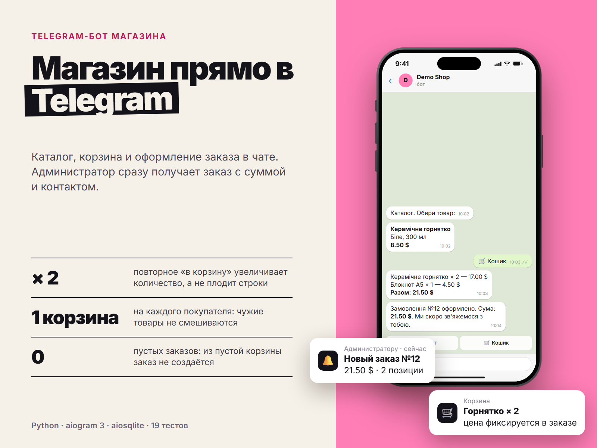

# Telegram Shop Bot

Telegram-бот интернет-магазина на Python: каталог, карточки товаров, корзина, оформление заказа и уведомления администратору. Готовая основа, которую можно быстро адаптировать под реальный магазин.



## Возможности

- Каталог с карточками товаров и кнопками (inline-клавиатуры)
- Корзина: добавление, очистка, подсчёт суммы
- Оформление заказа с сохранением цен на момент покупки
- Уведомление админов о новом заказе
- Админ-команды: `/add` (добавить товар) и `/orders` (последние заказы)
- Все тексты вынесены в один файл `bot/texts.py`, их легко перевести или изменить
- Тесты на слой данных и разбор команд

## Стек

Python 3.11+, [aiogram 3](https://docs.aiogram.dev/), aiosqlite (SQLite), python-dotenv, pytest

## Быстрый старт

```bash
git clone <ссылка-на-репозиторий>
cd telegram-shop-bot
python -m venv .venv
source .venv/bin/activate        # Windows: .venv\Scripts\activate
pip install -r requirements.txt
cp .env.example .env             # впиши BOT_TOKEN и ADMIN_IDS
python -m bot.main
```

При первом запуске создаётся база `shop.db` с тремя демо-товарами.

## Настройка

| Переменная | Описание |
| --- | --- |
| `BOT_TOKEN` | Токен бота из [@BotFather](https://t.me/BotFather) |
| `ADMIN_IDS` | Telegram id администраторов через запятую (свой id можно узнать у @userinfobot) |
| `DB_PATH` | Путь к файлу SQLite (по умолчанию `shop.db`) |

Валюта меняется константой `CURRENCY` в `bot/texts.py`.

## Команды

| Команда | Кто | Что делает |
| --- | --- | --- |
| `/start` | все | Приветствие и главное меню |
| `/catalog` | все | Каталог товаров |
| `/cart` | все | Корзина |
| `/add Название \| Цена \| Описание` | админ | Добавить товар |
| `/orders` | админ | Последние 10 заказов |

## Как это устроено

```
bot/
  main.py       запуск, сборка зависимостей
  config.py     настройки из переменных окружения
  db.py         работа с SQLite (товары, корзина, заказы), деньги хранятся в копейках
  handlers.py   логика диалога и админ-команды
  keyboards.py  клавиатуры и callback-данные
  texts.py      все тексты интерфейса
  parsing.py    разбор аргументов команды /add
  seed.py       демо-товары
tests/          pytest
```

Заказ создаётся в одной транзакции, а повторное нажатие «Оформить» не создаёт дубль благодаря блокировке на время оформления.

## Тесты

```bash
pip install -r requirements-dev.txt
pytest
```

## Что можно доработать

- Приём оплаты (Telegram Payments, Stripe, ЮKassa)
- Остатки товара и фото
- Статусы заказов и уведомления клиенту
- Переезд с SQLite на PostgreSQL для высокой нагрузки

## Контакты

Принимаю заказы на Telegram-ботов, парсеры и интеграции с API. Контакты: Telegram @welldonechief .

## Лицензия

MIT
